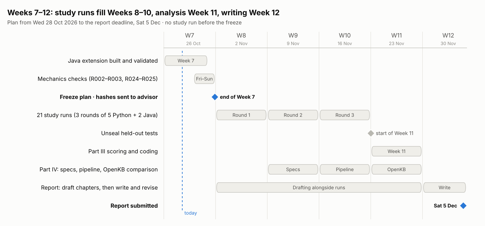

# Week-by-week plan: Weeks 7–12

*Evaluating and Extending Spec-Driven Development: GitHub Spec Kit and OpenOwls SD-KDP*

Varshil Patel · MS Computer Science, Temple University

The technical report is due **Saturday 5 December 2026**, the end of Week 12.
This plan replaces the Weeks 10–16 schedule in the [Weeks 5–9 report](WEEKS-5-9-REPORT.md)
(section 8): there are six weeks left, not ten, so the study runs, Part III and
Part IV all finish by Week 11, and Week 12 is for writing.

| Week | Dates | Focus | Gate at the end of the week |
| --- | --- | --- | --- |
| **7** | Mon 26 Oct – Sun 1 Nov | Java/Quarkus extension built and validated; pre-registration frozen; mechanics checks | Hashes sent to the advisor; no study run before this |
| **8** | Mon 2 Nov – Sun 8 Nov | Rounds 1–2: R004–R013 and their change requests (Python) + R026–R027 (Java) | Rounds 1–2 logged, every run `verify` OK |
| **9** | Mon 9 Nov – Sun 15 Nov | Round 3: R014–R018 and change requests + R028–R029; Part IV specs written | Round 3 logged; seven `ai_specs/` files exist |
| **10** | Mon 16 Nov – Sun 22 Nov | Round 4: R034–R038 and change requests + R030–R031; Part IV pipeline run | All 46 study runs done (20 builds, 20 change requests, 6 Java); distilled wiki built |
| **11** | Mon 23 Nov – Sun 29 Nov (Thanksgiving 26 Nov) | Unseal, score, code (Part III); OpenKB comparison (Part IV) | All results tables final |
| **12** | Mon 30 Nov – Sat 5 Dec | Write, advisor review, submit | Report submitted 5 Dec |

"You" below is the author (operator, researcher and product owner). "Claude"
is the AI assistant that drafts materials and scripts under the author's
direction, as disclosed in the Weeks 5–9 report.

---

## Week 7 · 26 Oct – 1 Nov · Extension, freeze, mechanics

**Goal:** everything the study runs depend on is frozen, and the procedure has
been exercised end to end on both stacks.

| # | Work | Who | Status |
| --- | --- | --- | --- |
| 7.1 | Java/Quarkus extension: 2 tasks, answer sheets, Java prompts, Quarkus skeleton and Java base builder, checker and scorer support, schedule rows R024–R033, requirement register rows, addendum `PREREGISTRATION-JAVA.md`, runbook section 7 | Claude | Done (this branch) |
| 7.2 | Java references, naive variants and 157 held-out test cases, kept outside the repository | Claude | Written; validation waits on Maven Central access |
| 7.3 | Validate the Java suites (references pass everything; naive variants pass tier A and fail tiers B/C); fill Appendix B | Claude | Waiting on Maven Central access |
| 7.4 | Review the Java task texts, answer sheets and held-out suites; change anything you disagree with **before** sealing | You | |
| 7.5 | Seal the Java archive with your passphrase, commit the `.enc` file, fill section 9 of the addendum | You | |
| 7.6 | Build both bases (`make_base.sh`, `make_base_java.sh`) and record their commits | You | |
| 7.7 | Mechanics checks R002, R003 (Python) and R024, R025 (Java); fix and log anything they reveal | You | |
| 7.8 | Freeze: fill section 11 of `PREREGISTRATION.md` and section 9 of the addendum, commit both in one commit, email the hashes of all three archives (Python builds, change requests, Java) to the advisor | You | |
| 7.9 | Ask the advisor to confirm the advisor of record (the proposal names Yan Wang; the Week 1 and Weeks 3–4 reports name Alex Pang) and the Dec 5 scope in this plan | You | Advisor of record: Yan Wang (decided 29 Oct) |
| 7.10 | Settle the open pre-registration decisions; `sddlog` 1.2 records tokens | Claude | Done (PR #4) |
| 7.11 | Fourth condition `sdd_secure`; a change request per Python task (existing-project stage) with 107 sealed held-out cases, validated; schedule regenerated for four conditions; `sddlog` 1.3 | Claude | Done: reviewed, validated (Appendix C) and sealed as `sealed/sealed-heldout-cr-v1.zip.enc`; its hashes are already in section 11 |
| 7.12 | Run tool `run_build.py`: drives each run in Claude Code's headless mode; the operator only classifies agent turns | Claude | Done; first real use is the mechanics checks (7.7) |

**Time needed from you:** about 2 h review, 1 h sealing and bases, 3–4 h
mechanics runs.

---

## Week 8 · 2–8 Nov · Round 1

| # | Work | Who |
| --- | --- | --- |
| 8.1 | Rounds 1 and 2 in schedule order, each build followed by its change request (`run_build.py R004`, then `run_build.py R004C`): R004–R008, then Java R026–R027, then R009–R013. See [weeks/week-08](../weeks/week-08/README.md) | You |
| 8.2 | After each run: `verify`, run log line, bundle, copy logs into the repository (runbook step 4) | You |
| 8.3 | Report skeleton: title page, abstract placeholder, introduction, background and the study design chapter, drafted from the proposal, the pre-registration and the research brief | Claude |

**Pacing.** Expect about 20–40 min of agent time for an `unstructured` run and
1–2.5 h for an SDD run (the practice SDD build took about 160 min); a change
request is usually shorter than its build. With `run_build.py` you only need to
be at hand to classify the agent's turns, so other work can go on meanwhile.
Plan 3–4 builds with their change requests a day, and leave headroom for usage
limits: an interrupted run is resumed or redone with a spare ID, as
pre-registered.

---

## Week 9 · 9–15 Nov · Round 2 + Part IV specifications

| # | Work | Who |
| --- | --- | --- |
| 9.1 | Round 3: R014–R018 with their change requests, then Java R028–R029. See [weeks/week-09](../weeks/week-09/README.md) | You |
| 9.2 | Part IV step 1: declare the Oracle for the SDD research literature, name at least 3 sources it rejects, and list its key questions | You |
| 9.3 | Part IV step 2: write the seven `ai_specs/` files (overview, domain knowledge, oracle, collection, distillation, output format, batch process) | You, Claude drafts |
| 9.4 | Part IV corpus list: 15–20 sources (preprints, the Spec Kit docs and blog posts, practitioner reports), each with its URL and licence noted | Claude drafts, you approve |
| 9.5 | Report: related-work chapter from the research brief, with every claim checked against its source | Claude |

---

## Week 10 · 16–22 Nov · Round 3 + Part IV pipeline

| # | Work | Who |
| --- | --- | --- |
| 10.1 | Round 4: R034–R038 with their change requests, then Java R030–R031. See [weeks/week-10](../weeks/week-10/README.md) | You |
| 10.2 | Optional replication R021–R023 and R039 (T-REDACT-01), **only if** round 4 is finished by Thursday 19 Nov | You |
| 10.3 | Part IV steps 3–4: `collect.py` and `distill.py`; run one source by hand and fix the **spec**, not the output, until the article matches the Oracle's voice and format; then the whole corpus, and the index | You, Claude scaffolds the scripts |
| 10.4 | Analysis scripts: per-task tables, paired differences, the 4-of-5 consistency rule, Friedman and Wilcoxon (reported, not relied on), and the Java cross-stack table | Claude |

**Gate:** all 46 study runs (20 builds, 20 change requests, 6 Java builds) are done and logged. The held-out suites stay
sealed until the last run is closed.

---

## Week 11 · 23–29 Nov · Part III scoring and coding, Part IV comparison

| # | Work | Who |
| --- | --- | --- |
| 11.1 | Unseal both archives and check their hashes against the pre-registration | You |
| 11.2 | Score every run (`score_run.py --sast`), with the Python suites for the Python runs and the Java suites for the Java runs | You (scripted) |
| 11.3 | Manual coding: traceability and security sheets, all runs of one task in one sitting, in the drawn order; confirm every probe failure by hand | You |
| 11.4 | Intra-rater check: re-code a random 30% of rows at least 5 days after first coding, and report Cohen's κ | You |
| 11.5 | Part IV: build OpenKB on the **same** corpus with the same LLM; ask both wikis the Oracle's key questions; fill the structural comparison (proposal Table 1) and the evaluation criteria from the research brief | You, Claude helps |
| 11.6 | Results tables and figures for RQ1–RQ5 | Claude |

Thanksgiving falls on Thursday 26 Nov. Scoring is automated, so plan the manual
coding (about 25 min per run, roughly 9 h in total) on the other days.

---

## Week 12 · 30 Nov – 5 Dec · Write and submit

| # | Work | Who |
| --- | --- | --- |
| 12.1 | Results chapters (RQ1–RQ4; Java cross-stack section; RQ5), discussion, threats to validity, conclusion | You, Claude drafts |
| 12.2 | Full draft to the advisor by **Tuesday 1 Dec** | You |
| 12.3 | Revise from the advisor's comments | You |
| 12.4 | Final checks: every number traces to a score file or `metrics.json`; every reference verified (see the reference table in the research brief); the AI-assistance disclosure is included | You, Claude checks |
| 12.5 | Submit by **Friday 4 Dec**, one day before the deadline | You |

**Report outline** (from the research brief): abstract; introduction and RQs;
background (SDD rigor levels, Spec Kit 1.0.6 workflow, related evidence labelled
peer-reviewed / preprint / grey); study design; heuristics used (task design
rules, constitution, stopping rule, answer-sheet rules); validation methodology
(held-out tiers, SAST, manual review, traceability coding, κ, statistics);
results RQ1–RQ4 (Python), Java extension, Part IV (RQ5); discussion;
threats to validity; conclusion and future work; appendices (prompts,
constitution, rubrics, raw data link).

---

## If the schedule slips

Cuts are made in this order, and each one is logged in the deviations log:

1. Drop the optional replication R021–R023 and R039 (already optional).
2. Part IV: compare the two wikis only structurally (proposal Table 1), without
   asking them the key questions.
3. Drop the Java runs of the last round not yet run (R030–R031), and report the
   Java extension as two tasks with an incomplete round.
4. Drop the change requests of round 4 (R034C–R038C), and report the change
   requests with one task missing from each condition pair. The 20 Python
   builds are never cut: they are the core of RQ1–RQ4.
