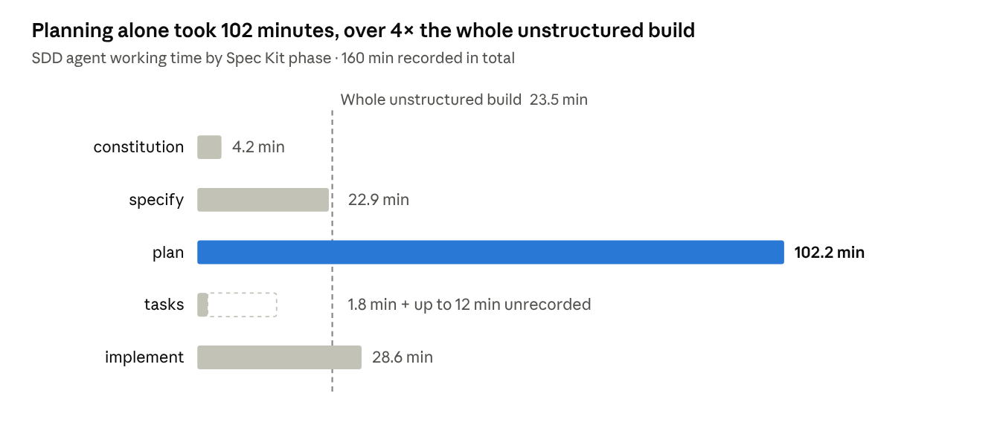
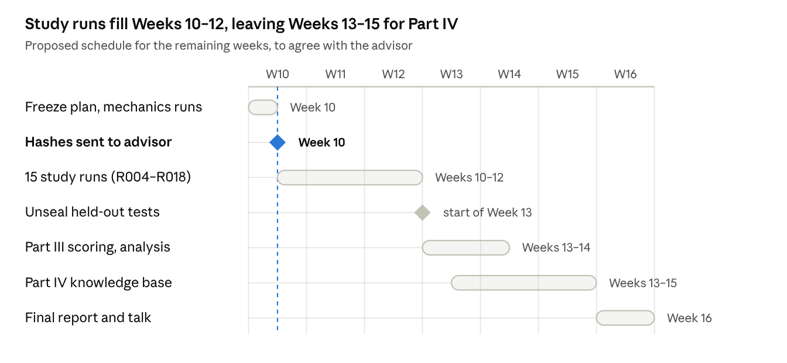

# Weeks 5–9 Plan and Report

*Evaluating and Extending Spec-Driven Development: GitHub Spec Kit and OpenOwls SD-KDP*

Varshil Patel

| | |
| --- | --- |
| **Student** | Varshil Patel |
| **Program** | MS Computer Science, Temple University |
| **Faculty Advisor** | Alex Pang |
| **Reporting Period** | Weeks 5–9 of 16 — Part II: Data Collection (preparation) |
| **Milestone** | Milestone 3 — Study design, instruments and practice comparison |
| **Deliverables** | Pre-registration; matched task set with sealed held-out tests; instrument v1.1; practice comparison |

## 1. Purpose and Status

The controlled study is fully designed and its instruments are built and validated, but none of its 15 measured runs has been carried out yet. Weeks 5–7 were planned for data collection. They went instead into what the Weeks 3–4 report listed as prerequisites: a matched task set with held-out tests written before any run, a fixed stopping rule, pre-registered rubrics, and a decision on the clarify stage.

One practice comparison was also run on a separate login task, to exercise the whole procedure end to end. It is excluded from the study's data, and nothing in this report is a finding about SDD's effectiveness.

The study is about five weeks behind the proposal's timeline. Section 8 proposes a revised schedule for the remaining weeks.

## 2. Activities Completed

### 2.1 Study design: three conditions, five tasks, 15 runs

The design is within-subject and task-matched: 5 tasks × 3 conditions = 15 study runs, all with one agent harness (Claude Code), one model, and Spec Kit 1.0.6, the version used for R001.

| Condition | What it is |
| --- | --- |
| `unstructured` | The task text as one prompt, in one session, with no Spec Kit in the repository |
| `sdd` | Spec Kit's default sequence: constitution → specify → plan → tasks → implement |
| `sdd_clarify` | The same, with `/speckit-clarify` between specify and plan |

The third condition answers the Weeks 3–4 open question: the pilot found that ambiguity was absorbed silently without clarify, so clarify is now a manipulated factor rather than an optional extra.

The run order is counterbalanced. Each task follows one of the six possible condition orders, and runs are grouped into three rounds so that a task's three runs are at least four runs apart. Two mechanics checks on the pilot task (R002, R003) come first and are excluded from analysis. The schedule is generated from a fixed seed (20261023) and is reproducible.

### 2.2 Pre-registration

A pre-registration fixes, before any study data exists, every decision that could otherwise be made after seeing the data:

- **Every prompt the operator types.** The constitution and plan prompts are now generic and identical for every task. In R001 the plan prompt named the modules to build, which put the operator's design into the SDD output.
- **A stopping rule.** A run is done when every example in the task text behaves as shown. A script checks this and prints the follow-up message in fixed wording, so the operator's own phrasing never enters the data. Runs are capped at 5 follow-ups or 90 minutes.
- **Answer sheets.** Each task has 3–4 deliberately open points with product-owner answers written in advance. Any question an agent asks, in any condition, gets the verbatim answer; questions not covered get one of two fixed replies.
- **Measures, rubrics and the analysis plan** for RQ1–RQ4, including a security severity rubric, a 0–2 traceability score, and the rule that a difference counts as consistent only if it holds in at least 4 of 5 tasks.

With five pairs, the smallest possible two-sided p-value for an exact Wilcoxon test is 0.0625. The plan therefore states in advance that no pairwise test can reach α = 0.05, and that results will be reported descriptively.

### 2.3 Instrument v1.1

`sddlog` was extended to support the third condition. The verification gate now checks each run's completed phases against its condition: a missing phase, a phase outside the condition, or phases out of order raise a warning. Ten new tests bring the suite to 67, all passing. The logging protocol was updated to version 1.1.

Every run now starts from a fresh clone of one base repository that holds only the instrument and its hooks. The SDD conditions add Spec Kit in one recorded setup commit. Spec Kit installs its commands as skills the model can invoke on its own, so leaving them in the shared base would contaminate the unstructured condition.

### 2.4 Task set and held-out test suites

Five standard-library Python tasks were written for the study, graded in size. Each has a fully specified interface, so black-box tests apply unchanged to any implementation, and a realistic security weakness that the task text never mentions.

| Task | What the agent builds | Size of reference (SLOC) | Security weaknesses probed (CWE) |
| --- | --- | --- | --- |
| T-REDACT-01 | Log redactor (emails, IPs, card numbers) | 95 | 1333, 532 |
| T-TARX-01 | Tar archive list/extract tool | 107 | 22, 59, 732 |
| T-BOOKMARKS-01 | SQLite bookmark manager | 124 | 89, 155, 1236 |
| T-ACCOUNTS-01 | Password account store with lockout | 144 | 256, 759, 916, 204, 732 |
| T-PASTE-01 | HTTP paste service | 180 | 22, 330, 200, 400, 79 |

The held-out suites hold 157 test cases in three tiers: 107 for stated behaviour (tier A), 16 for the deliberately open points (tier B), and 34 security probes (tier C). They are sealed in an archive whose SHA-256 hash is recorded in the pre-registration, to be sent to the advisor before the first study run.

### 2.5 Validation of the test suites

Each suite was run against its reference implementation and against one or two deliberately naive versions. These used common shortcuts, such as tutorial regexes, `tarfile.extractall`, f-string SQL, unsalted SHA-256 and sequential ids.

- The references pass every test.
- The naive versions pass 96–100% of tier A but only 0–70% of tier C, so stated-behaviour tests alone would not separate safe code from unsafe code.
- Bandit, the static-analysis tool, flagged only two of the naive defect types (SQL injection and unsafe archive extraction). This supports combining probes, static analysis and manual review, as the proposal planned.
- Every naive version still meets the stopping rule, so the task examples do not leak the held-out tests.

### 2.6 Practice comparison on a login task

A sixth task, T-LOGIN-01 (a standard-library login page with HS256 JWT sessions lasting 30 minutes), was built with its own 41-check held-out suite. It was run once unstructured and once through the full Spec Kit sequence, to test the procedure end to end. Section 4 gives the results.

## 3. Deliverables

| Deliverable | Status | Location |
| --- | --- | --- |
| Pre-registration (design, prompts, stopping rule, rubrics, analysis plan) | Complete; to be frozen with a commit before R004 | `docs/PREREGISTRATION.md` |
| Operator runbook | Complete | `docs/RUNBOOK.md` |
| Logging protocol v1.1 and `sddlog` v1.1 (67 tests) | Complete | `docs/LOGGING-PROTOCOL.md`, `sddlog-v1.1.patch` |
| Matched task set (5 tasks) with answer sheets and examples | Complete | `tasks/`, `operator/answer-sheets/` |
| Sealed held-out suites (157 test cases) and references | Complete, sealed | `sealed-heldout-v1.zip` |
| Counterbalanced schedule (R002–R018) | Complete | `schedule/schedule.csv` |
| Scoring and coding tools for Part III | Complete | `tools/study/` |
| Practice comparison (T-LOGIN-01) | Complete; excluded from analysis | `login-demo-results.zip` |
| Mechanics checks R002–R003 | Not started | — |
| 15 study runs R004–R018 | Not started | — |

## 4. Practice Comparison: T-LOGIN-01

Both builds met every stated requirement and passed every security probe; SDD differed only in traceability and in one open point it asked about, at about 7 times the agent time. This is one run per condition, so it shows the procedure working, not which method is better.

### 4.1 Setup

- **Same task text for both.** The 405-word description of a standard-library login page with HS256 JWT sessions lasting 30 minutes was identical in both conditions; only the workflow differed.
- **Agents.** The builds were made by AI agents (Claude subagents) in a cloud workspace, not by Claude Code with the study's hooks and model. The unstructured build used one fresh agent; the SDD build used a fresh agent for each of the five Spec Kit phases.
- **Tests frozen first.** The 41-check held-out suite was written and hashed before either agent ran, kept encrypted while they worked, and re-verified against its hash before scoring.
- **Same procedure as the study.** The fixed prompts, the stopping rule and the answer-sheet rules were applied exactly as pre-registered.

### 4.2 Results

| Measure | Unstructured | SDD |
| --- | --- | --- |
| Stopping rule met | 1st check, 0 follow-ups | 1st check, 0 follow-ups |
| Tier A, stated behaviour | 22/22 | 22/22 |
| Tier B, open points | 1/4 | 2/4 |
| Tier C, security probes | 15/15 | 15/15 |
| Confirmed security defects | 0 | 0 |
| Tests citing a requirement ID | 0 of 72 | 90 of 90 (all 32 requirements) |
| Product / test source lines | 612 / 549 | 518 / 1,458 |
| Questions the agent asked | 0 | 2 |
| Human turns | 1 | 7 (5 phase prompts, 1 answer, 1 restart after an outage) |
| Agent working time | 23.5 min | about 160 min, plus up to 12 min unrecorded |
| Agent tokens | 118,000 | about 945,000 |
| Specification documents produced | none | 27,891 words in 7 documents |
| Spec revisions after the plan phase | n/a | 0 |

The security probes covered forged and unsigned (`alg: none`) tokens, tampered payloads, cookie flags, salted password storage, user enumeration, cross-site scripting, open redirects and oversized requests. Bandit reported one low-severity finding per build; both were checked by hand and are false positives (constant names containing "SECRET" and "PASSWORD").

**The open points (tier B):**

| Open point | Unstructured | SDD | Why |
| --- | --- | --- | --- |
| Lock a username after 5 failures for 15 minutes, same 401 response | Fail | Pass | SDD asked and was answered; unstructured chose 10 failures and a 429 response |
| Logout invalidates a copied token | Pass | Pass | SDD asked; unstructured chose the same behaviour unprompted |
| Usernames are case-insensitive | Fail | Fail | Neither asked |
| `/login` redirects a logged-in user to the dashboard | Fail | Fail | Neither asked |

### 4.3 Where the SDD time went

*Agent usage records, practice run D002 (SDD) and D001 (unstructured), 23–24 Oct 2026.*

The four phases before implement took over 80% of SDD time; in R001 the figure was 74%. The plan agent spent most of its time running its own trials to settle design details, such as how the server parses request paths.

## 5. What the Work So Far Suggests

The pilot (R001) and the practice comparison point the same way on cost and on the feedback loop, and give a first hint about where any benefit comes from. All of it rests on one run per condition, so these are hypotheses for the study to test, not findings.

| RQ | What R001 and the practice run suggest | How the study tests it |
| --- | --- | --- |
| RQ1 correctness and defects | No difference on stated behaviour or security: both login builds passed every check. A capable model told to build something "secure" may already meet the probed security bar without SDD | Tier A and tier C pass rates and confirmed findings across 5 tasks whose security needs are not mentioned in the task text |
| RQ2 traceability | A clear difference: every SDD test named the requirement it checks, against none in the unstructured build | Traceability coding (0–2 per requirement) and the share of explicit requirement links |
| RQ3 time and effort | SDD cost about 7× the agent time and 8× the tokens. The phases before implement took over 80% of SDD time, against 74% in R001 | Active time, turns and words per run, and how they scale with task size |
| RQ4 which stages matter | SDD's one extra correct point came from a question it asked; both builds missed the two points neither agent asked about. Asking, not writing specs, may be where the benefit lies. As in R001, no upstream document was revised after it was written | Tier B pass rate for `sdd_clarify` against `sdd`; questions asked; spec revisions after planning |

Two observations repeat across both SDD runs so far. First, the generated documents grow far faster than the code they govern: 7,580 words for 325 lines in R001, and 27,891 words for 518 lines here. Second, "fix the spec, not the output" did not happen in either run: the only change to any upstream document was ticking checkboxes in `tasks.md`.

## 6. Deviations and Problems Fixed

Two deviations occurred in the practice run. Validation and the practice run also caught six problems in the study materials before any study data existed, and one tool was extended. All six are fixed, or scheduled to be fixed before the pre-registration is frozen.

| Date | Where | What happened and what was done |
| --- | --- | --- |
| 2026-10-24 | Pre-registration, security rubric | The rule accepts scrypt only at N ≥ 2¹⁷, r = 8, p = 1, but OWASP lists equivalent settings; the unstructured login build used one of them (N = 2¹⁴, r = 8, p = 5). Section 7.2 will be reworded to "meets an OWASP Password Storage configuration" before freezing |
| 2026-10-23 | Practice run, SDD tasks phase | The agent stopped on an API usage limit partway through. The same agent was resumed the next morning with one fixed message, and the interruption was logged. That phase's clock time is invalid; the agent's own usage record is used instead, and up to 12 minutes of its first turn are unrecorded |
| 2026-10-23 | Practice run, both conditions | The agents ran outside Claude Code, so the hooks that record prompts and real-time activity never fired and `active_seconds` is unavailable. Time and effort come from the agents' usage records. The study runs, in Claude Code, will use the hooks as designed |
| 2026-10-23 | Stopping-rule checker | Extended to handle setup steps, server environment, cookies and redirects, which login-style tasks need. All five study tasks were re-checked and behave as before |
| 2026-10-23 | T-ACCOUNTS-01 reference | Its scrypt setting (N = 2¹⁵) was below the OWASP minimum the rubric uses. Switched to PBKDF2-HMAC-SHA256 with 600,000 iterations; every tier still passes |
| 2026-10-23 | T-REDACT-01 reference | A card number directly after another number, such as an IP address, was not redacted. Fixed; a naive variant had the same bug, and tier A catches it |
| 2026-10-23 | T-PASTE-01 security probe | A check that the delete token does not contain the paste id fired on strong random tokens whenever the id was short. Narrowed to length, uniqueness and token ≠ id |
| 2026-10-23 | T-BOOKMARKS-01 security probe | A title starting with `-` was read as a command-line option, so the probe tested argument parsing rather than CSV output. That case was dropped; `=`, `+` and `@` remain |
| 2026-10-23 | T-PASTE-01 security probe | The probe planted files in a folder before creating it. Fixed |

## 7. Risks, Limitations and Open Questions

The largest risk is time: SDD runs may take far longer than the pilot suggested, and Part IV has not started.

**Risks to the schedule**

- **SDD runs may take 1–3 hours each.** R001 took 29 minutes, but the practice SDD build took about 160 minutes of agent time, 102 of them in the plan phase. The study tasks are smaller than the login task, but the 15 runs could need 15–35 hours rather than the 12–15 first estimated.
- **Usage limits can interrupt a run,** as happened once in the practice run. Runs should be scheduled with headroom; the pre-registered rule is to log the interruption and resume, or redo the run with a spare ID.
- **Part IV has not started.** The OpenOwls SD-KDP and OpenKB environments are not yet set up.

**Limits on what the study can show**

- **One run per cell.** Model output varies between runs, so a difference seen in one task may be noise. The design requires a difference to hold in at least 4 of 5 tasks, and an optional replication of one task is scheduled if time allows.
- **One harness and one model.** Results will apply to Claude Code with that model, not to SDD in general.
- **The operator is also the researcher,** and is not blind to condition. Fixed prompts, machine-generated follow-ups, verbatim answers and caps limit the operator's influence.
- **SDD without human review of the specs.** To keep the operator's judgement out of the SDD output, generated documents are not read or edited during runs. The study therefore cannot show what careful human review would add, and SDD's real cost would be higher.

**Disclosure of AI assistance**

The task set, reference implementations, held-out tests, tools, pre-registration and this report were drafted with an AI assistant (Claude, by Anthropic) under the author's direction, and the practice comparison was run by Claude agents. Claude is the same model family as the agent under test, which the pre-registration lists as a threat to validity. The author reviews all study materials before freezing them. This use should be checked against the program's policy on AI assistance.

**Open questions for the advisor**

- Confirm the advisor of record: the proposal names Yan Wang; the Week 1 and Weeks 3–4 reports name Alex Pang.
- Agree the revised schedule in Section 8, including the narrower Part IV.
- Confirm that a descriptive analysis of 15 runs, with no claim of statistical significance, meets the study's requirements.

## 8. Revised Plan for Weeks 10–16

All 15 study runs can still finish by the end of Week 12 if the pre-registration is frozen in Week 10; Part IV then has three weeks instead of four.

*Proposed schedule · Weeks 10–16 · 2 gates.*

No study run starts until the pre-registration is frozen and its hashes are sent to the advisor, and the held-out tests stay sealed until the last run is done. To fit the remaining time, three changes are proposed:

- **Part III compressed** from four weeks (Weeks 8–11 in the proposal) to about one and a half. Scoring and the coding sheets are already automated, so the remaining work is the manual coding and the write-up.
- **The optional replication (R021–R023)** runs only if the 15 study runs finish by the middle of Week 12.
- **Part IV narrowed** to one small corpus (the spec-driven development literature itself, as the proposal suggests), with the collect–distill–index pipeline run by hand rather than as a scheduled nightly job. The structural comparison with OpenKB stays as planned.

## 9. Materials

Everything above is in three archives, to be committed to the study repository when the pre-registration is frozen.

| Archive | Contents |
| --- | --- |
| `sdd-study-kit-v1.zip` | Pre-registration, runbook, logging protocol v1.1, `sddlog` v1.1 and its patch, the five task texts with examples and answer sheets, fixed prompts, schedule, run log, requirement register, and the tools for building the base repository, checking the stopping rule, scoring and coding |
| `sealed-heldout-v1.zip` | The 157 held-out test cases, the five reference implementations, and the validation evidence (naive variants, their scores, the validation report). Kept closed until all study runs are finished; its hash is recorded in the pre-registration |
| `login-demo-results.zip` | The practice comparison: both run repositories with their event logs and Spec Kit documents, their scores, the T-LOGIN-01 task and its now-unsealed tests, and the extended stopping-rule checker |
